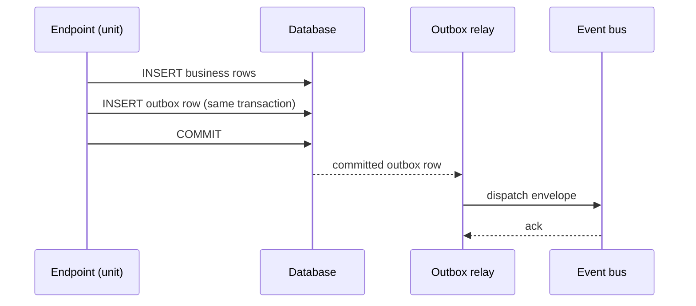

# Units of Work and `db()`

A **unit** is one Unit of Work: one transaction on one database. It commits
when its body succeeds and rolls back on any exception, `HTTPException`
included. Your code never commits: it reads and writes through `db()`, the
session of the running unit, and the framework decides commit or rollback at
the unit's end. Everything the unit queued (events, audit rows, post-commit
callbacks) commits with it or not at all.

## What you get by default, and what you declare

| You write | Sandloom does for you |
| --- | --- |
| `db().add(row)`, `await db().flush()` in a service | the request's unit: created at the first `db()`, committed before the response on success, rolled back on error |
| nothing | one transaction per request; the commit runs `before_commit` checks, `COMMIT`, outbox dispatch and `on_commit` callbacks, in that order |
| `await E(...).publish()` | an outbox row in the same transaction, dispatched only after the commit |
| `record_audit(...)` | an audit row in the same transaction |
| `await on_commit(callback)` | the callback runs only after the commit, never after a rollback |
| `async with open_uow() as session:` | a unit of your own: in a task, a script, a child task or an operation-intent route |
| `async with db().begin_nested():` | a savepoint; raising inside it rolls back to it and drops the effects queued inside it |

## Using `db()`

```python
from sandloom.sdk import db


async def create(body: NoteIn, *, author_id: UUID) -> Note:
    note = Note(author_id=author_id, **body.model_dump())   # tenant_id from the bound tenant
    db().add(note)
    await db().flush()   # materialise ids and constraints; never commit()
    return note
```

- **Never call `commit()` or `rollback()`** on a session in module code
  ([SANDLOOM-C006](../reference/error-codes.md#sandloom-c006)). Use `flush()` to get
  ids and constraint errors early.
- **`db()` is synchronous.** Outside any unit it raises
  `UnitOfWorkRequiredError` ([SANDLOOM-R002](../reference/error-codes.md#sandloom-r002)).
- **In a request** the first `db()` creates the request unit lazily: no
  connection is checked out until the first statement. A read route that
  never calls `db()` uses no connection. Routes may still take the session as
  a parameter (`DbSession`, advanced, from `sandloom.sdk.web`); the unit is then
  opened eagerly, and on a write route the durable idempotency claim runs
  before the handler.
- **In a contract method** `db()` is the provider unit's session, on the
  contract pool with its tenant hook ([Contracts](contracts.md)).
- **In a consumer** `db()` is the delivery's unit; a delivery that raises
  rolls back and is redelivered ([Events](events.md)).
- **In a task or script** open a unit with `open_uow()`; inside the block
  `db()` returns its session ([Background tasks](background-tasks.md)).

`open_uow(database=None)` opens a unit on the module's primary database, or
on a named one. It replaces today's ad-hoc sessions and is the only way to
open a unit outside a request, a consumer or a contract.

## Ownership: one task per unit

A unit belongs to one asyncio task. In a request the owner is the handler
task, the task that runs the dependencies and the endpoint.

- **`db()` from another task is refused** with `ConcurrentSessionUseError`
  ([SANDLOOM-R013](../reference/error-codes.md#sandloom-r013)). Child tasks
  (`asyncio.create_task`, `asyncio.gather`) inherit the context, so the
  common mistake is caught at the child's first `db()`. A child that calls
  `db()` before the parent did creates nothing: the parent's later `db()`
  creates the request unit and owns it.
- **A child task that needs the database opens its own unit:**

  ```python
  from sandloom.sdk.data import open_uow  # sandloom: advanced child task needs its own unit


  async def refresh_one(item_id: UUID) -> None:
      async with open_uow():
          item = await db().get(Item, item_id)   # db() is this unit's session
          ...

  await asyncio.gather(*(refresh_one(i) for i in ids))
  ```

  Write admission still applies: the first unit of the request that writes
  becomes its writer, so a child may be the only writer under a read-only
  parent, and is refused when another unit already wrote
  ([Write admission](write-admission.md)).
- **Passing a session object to another task is unsupported.** The framework
  detects it on a best-effort basis (session methods, the cursor), but some
  forms cannot be detected: in-place mutation of a mutable column value (for
  example `obj.data["k"] = v` on a JSON column without `MutableDict`),
  attribute assignment on a loaded instance, and direct use of the session's
  internals. Do not rely on detection; open a unit per task.
- **After a unit ends** its session is closed and marked. Any later use of a
  captured reference raises [SANDLOOM-R002](../reference/error-codes.md#sandloom-r002)
  instead of silently starting a new transaction.

## Commit, rollback, cancellation

- The commit runs, in order: `before_commit` checks, the commit-time session
  re-check when it is armed ([Route policy](route-policy.md)), `COMMIT`,
  outbox dispatch, `on_commit` callbacks.
- The request unit commits **before** the response is sent: a client never
  acts on a `200` whose write is not yet visible.
- Cancellation is an exception: the unit rolls back. Cancellation during
  `COMMIT` is an ambiguous commit, resolved by the dedupe records of the
  effect model ([ADR-0005](../adr/0005-effect-model.md)).
- **Savepoints.** `db().begin_nested()` uses the same session. A rolled-back
  savepoint discards the effects registered inside it (events, audit rows,
  callbacks). After a call that may roll back a savepoint, read
  `entity.id` before the call: a rollback expires ORM instances on async
  sessions.

## Events and audit go through the unit

`await E(...).publish()` writes the event to the `outbox_messages` table in
the same transaction. After the commit a dispatcher pushes it to the bus; the
relay retries any dispatch that failed. So an event is published **if and only
if** the change that produced it commits.



- The publish preflights the channel, the schema and the payload size inside
  the transaction, so an event the bus would reject is never committed.
- **Outside a unit, publishing raises** `UnitOfWorkRequiredError`. A
  deliberately lossy publish passes `required=False` to the L2
  `publish_event` and needs a marker on the call:
  `# sandloom: best-effort <reason>`
  ([SANDLOOM-C007](../reference/error-codes.md#sandloom-c007)).
- `record_audit` follows the same rule ([Audit](audit.md)).
- **The relay.** A failed dispatch is retried with exponential backoff
  (`OUTBOX_RELAY_BACKOFF_BASE_SECONDS`, default 2, doubled per attempt, capped
  at `OUTBOX_RELAY_BACKOFF_MAX_SECONDS`, default 300). When the broker itself
  is down the relay opens a circuit and cools down
  (`OUTBOX_RELAY_CIRCUIT_BASE_SECONDS` / `_MAX_SECONDS`, defaults 1 / 30). A
  row that exhausts `OUTBOX_RELAY_MAX_ATTEMPTS` (default 10) is dead-lettered
  (`dead_at` set, `outbox_dead_total` incremented); return it with
  `sandloom outbox list-dead` and `sandloom outbox requeue`. The envelope id is
  unchanged, so consumers that already applied it dedupe it.
  `OUTBOX_RELAY_ENABLED=auto` runs the relay in production processes only
  (one elected worker per container under gunicorn); turning it off in a
  production app process needs the accepted risk `relay_disabled`.

## Effects that wait for the commit, checks that run before it

- **`await on_commit(callback)`** (sync or async, no arguments) runs right
  after the unit commits. It never runs after a rollback, nor when it was
  registered inside a savepoint that rolled back. Outside any unit it runs at
  once. A failing callback is logged and never fails the committed request.
  Use it for effects outside the database: a cache write, a notification.
  Revoking a user's tokens has its own helper,
  `revoke_user_tokens_on_commit` (`sandloom.sdk.security`).
- **`await before_commit(callback)`** (`sandloom.sdk.effects`) runs after the
  handler, right before `COMMIT`; raising rolls the unit back. Use it to
  re-validate an input owned by another service. It narrows a race window to
  "check, then COMMIT"; it does not close it.

## One database per invariant

Each database has its own unit and transaction; there is no distributed
transaction. One business invariant belongs in one database. A route writes
to one database, its write store; a second writing unit in the same request is
refused at its first write ([Write admission](write-admission.md)). When two
databases must stay consistent, use events or a saga, never a shared
transaction.

A write that must survive the request's rollback (rare) needs its own
transaction opened after the request, never nested inside it. A route whose
job is a sequence of short units around an external call (billing checkout)
uses the operation-intent mode ([Lifecycle](lifecycle.md)).

## What breaks it

| Code | What it catches |
| --- | --- |
| [SANDLOOM-C006](../reference/error-codes.md#sandloom-c006) | `commit()` / `rollback()` in module code |
| [SANDLOOM-C007](../reference/error-codes.md#sandloom-c007) | a best-effort publish or audit without a marker |
| [SANDLOOM-C020](../reference/error-codes.md#sandloom-c020) | a hand-written session dependency without `scope="function"` |
| [SANDLOOM-R002](../reference/error-codes.md#sandloom-r002) | `db()` or an effect outside any unit; a closed unit reused |
| [SANDLOOM-R013](../reference/error-codes.md#sandloom-r013) | `db()` from a task that does not own the unit |
| [SANDLOOM-R007](../reference/error-codes.md#sandloom-r007) | a second writing unit in one request |
| [SANDLOOM-R008](../reference/error-codes.md#sandloom-r008) | nested or overlapping units where they are not allowed |

??? note "Guarantees, precisely"

    - Commit on success, rollback on any exception, before the response;
      the commit pipeline order `before_commit` → COMMIT → outbox dispatch →
      `on_commit` (G-UOW-01, G-UOW-02, G-UOW-04).
    - A rolled-back savepoint drops the effects registered inside it
      (G-UOW-05).
    - `db()` is the innermost open unit's session; outside any unit SANDLOOM-R002;
      the lazy request unit is created only by the handler task; a closed
      unit refuses reuse (G-UNIT-01).
    - `db()` from a non-owner task is SANDLOOM-R013 (C-UNIT-01). Detection of a
      session passed to another task is **best-effort**, not a guarantee; the
      undetectable forms above are pinned by tests (C-UNIT-02).
    - The outbox gives no loss between the commit and the bus; delivery is
      at-least-once (G-OUTBOX-*). The full effect matrix: [ADR-0005](../adr/0005-effect-model.md);
      the labels: [Guarantees and labels](guarantees.md).

    The ledger with the enforcing tests: [Guarantees & capabilities](../reference/guarantees.md).

??? info "Kinds of unit"

    request unit (`db()` / `DbSession` in a request), named request unit
    (`Database("x")`), block unit (`open_uow()`), consumer unit, contract unit
    (a command unit, or a read unit / the request's shared read-scope
    connection), planned read, task unit, saga-step unit, and the kernel's own
    units (outbox marking, post-commit dispatch, guard bookkeeping). Each
    route kind and each non-route unit has one row in the
    [lifecycle matrix](lifecycle.md).

## Design rationale

- [ADR-0005: the effect model](../adr/0005-effect-model.md)
- [ADR-0010: Public API 1.0](../adr/0010-public-api-1.0.md), "Transaction and replay lifecycle"
