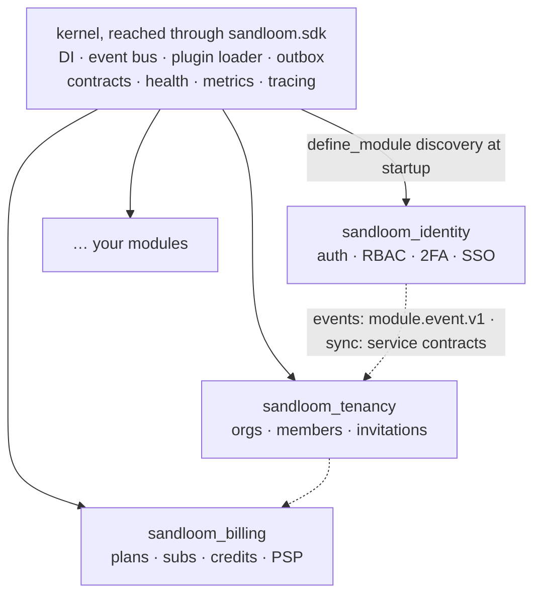

# Sandloom Framework

**A configurable monolith for building SaaS.** One codebase, one image — deploy
it as a monolith today and split it into microservices later by changing an
environment variable. No rewrites.

!!! note "Code and topology by configuration — data by migration"
    The split is a configuration change for the code and the topology (which
    process loads which module, in-process vs RPC contracts, which database a
    module uses). It does **not** move live data: extracting a module from a
    running monolith also means moving its tables (with its migration version
    row and pending outbox events) into the new service's database — an
    offline maintenance-window step done by `sandloom migrate extract-module`; see
    [Extracting a module](guides/deployment.md#extracting-a-module-into-its-own-service). Which
    infrastructure backends are production-ready vs contract-only is listed in
    [What ships today](concepts/capabilities-and-infrastructure.md#what-ships-today).

Sandloom is a *golden path* for rapid SaaS development with AI coding agents: every
business module is **atomic and isolated**, so a developer (or an agent) can
build or modify one module without understanding — or breaking — the rest of the
system. AST-based architecture tests enforce that isolation in CI.

!!! tip "Start here"
    New to Sandloom? Start with the **[quickstart](getting-started/index.md)**:
    create your own application, add a module, run the gates and start the API.
    Then follow **[Tutorial: your first feature](getting-started/tutorial.md)**
    to connect two modules with an event and a typed contract.

-   :material-school: **[Tutorials](getting-started/index.md)**

    Learn by doing: quickstart, then two modules, an event, a contract call
    and tests. Installation and building a product on the wheel.

-   :material-book-open-variant: **[How-to guides](guides/index.md)**

    Do one task: add a module, an event, a contract, a consumer, a saga or a
    projection; write a migration; make a write idempotent; deploy; operate.

-   :material-api: **[Reference](reference/index.md)**

    Look it up: the `sandloom.sdk` Python API, the error catalogue, testing, the
    CLI, configuration, the security model, the bundled modules.

-   :material-cube-outline: **[Concepts](concepts/index.md)**

    Understand why: modules and levels, units and `db()`, route policy and
    sessions, events, contracts, guarantees, and the decision records.

For agents, the short always-loaded map is the repository's `AGENTS.md`, and a
machine-readable index of this site is <a href="llms.txt"><code>llms.txt</code></a>. Every page is
also served as Markdown: append `index.md` to its HTML directory URL, e.g.
`concepts/route-policy/index.md`. On any `error[SANDLOOM-...]`, run
`sandloom explain <code>` or read the [error catalogue](reference/error-codes.md).

## Why Sandloom

- **Monolith ↔ microservices via config.** `SANDLOOM_MODULES` decides which modules a
  process loads. The same image runs everything in one process or one service
  per module behind a gateway.
- **Atomic modules.** Business modules import only `sandloom.sdk`, generated
  contract stubs and DTOs, never each other. They talk through typed,
  versioned events (`billing.credits.spent.v1`) and typed contracts
  (`tenancy.membership.v1`).
- **Batteries included.** [Identity](modules/identity.md) (JWT auth, RBAC, 2FA,
  SSO), [Tenancy](modules/tenancy.md) (organizations, roles, invitations), and
  [Billing](modules/billing.md) (subscriptions, credit ledger, Stripe) ship as
  ready modules.
- **Infrastructure is pluggable.** Databases, caches, object stores, task
  queues, and the event bus are reached through capability contracts; the
  concrete backend is selected purely by configuration.

## Architecture at a glance

The core provides uniform access to infrastructure behind a stable facade;
infrastructure is swappable without touching modules.

## Quick start

Follow the [quickstart](getting-started/index.md), then the
[tutorial](getting-started/tutorial.md). To work on the framework
itself, [Installation](getting-started/installation.md) sets up the checkout.
